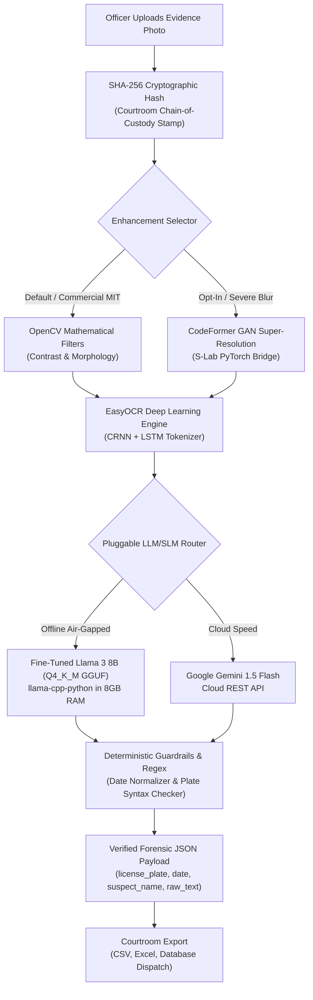

# Police Forensics AI: Cyber Command Terminal 🚓

[](https://github.com/GorangSinghal/PoliceForensicsAI/actions/workflows/ci.yml)
[](https://huggingface.co/GorangSinghal/PoliceForensics_Llama3_8B)
[](https://opensource.org/licenses/MIT)
[](https://www.python.org/downloads/)
[](https://pytorch.org/)
[](frontend/)
[](src/api.py)

**PoliceForensicsAI** is an enterprise-grade forensic evidence extraction and super-resolution system engineered for law enforcement precincts and air-gapped forensic laboratories. The platform pairs deep-learning generative restoration (CodeFormer GAN) with a custom fine-tuned Small Language Model (SLM) based on **Llama 3 8B** quantized to 4-bit GGUF, enforcing strict deterministic guardrails to prevent AI hallucinations.

> **Law Enforcement Validation:** Developed and audited for operational law enforcement workflows, this platform was presented and demonstrated in an official training programme for **150+ Rajasthan Police personnel** under the guidance of Dr. Gyan Singh (HoD, CSE) and Mr. Abdul Javed at the Indian Institute of Information Technology (IIIT) Kota.

---

## ⚡ Key Capabilities

* **Dual-Tier Image Preprocessing (Licensing Isolation):**
  * **OpenCV Mathematical Filter (Default - Commercial MIT):** Dynamic contrast normalization, morphological sharpening, and edge enhancement. 100% MIT-licensed and safe for unencumbered commercial enterprise deployment.
  * **CodeFormer GAN Bridge (Opt-In - Research S-Lab):** For severe facial degradation and degraded license plate crops, users can toggle the PyTorch GAN super-resolution bridge to synthesize lost high-frequency details.
* **Pluggable Edge-to-Cloud SLM/LLM Engine:**
  * **Offline Air-Gapped Mode (Primary):** Runs a custom fine-tuned **Llama 3 8B** model quantized to `Q4_K_M` GGUF (4.92 GB) via `llama-cpp-python`. Engineered with strict 8GB laptop RAM constraints (`n_ctx=256`, `n_batch=8`, `n_threads=2`, `use_mmap=True`) for edge deployment on standard precinct laptops.
  * **Gemini Cloud Mode (Fallback):** Google Gemini Flash integration with exponential backoff (`tenacity`) for high-throughput cloud batch processing.
* **Cryptographic Chain-of-Custody (SHA-256):** Computes an immutable SHA-256 cryptographic digest upon image upload to guarantee evidentiary integrity against digital tampering in legal proceedings.
* **Deterministic Guardrails & Abstention Logic:** Enforces SpaCy/Regex pattern matching, fuzzy date normalization, and strict schema validation, achieving 49/50 plate matches and 0 false plate numbers on 50 non-vehicle financial receipts.
* **Decoupled Modern Architecture:** Decoupled FastAPI REST backend (`src/api.py`) paired with a modern React + Vite + TailwindCSS Cyber Command Dashboard (`frontend/`) featuring Framer Motion telemetry animations. Retains legacy Gradio interface (`src/app_legacy.py`) for single-script offline deployments.

---

## 🏗️ System Architecture



---

## 📊 Empirical Benchmarks & Evaluation Reports

The fine-tuned SLM and multimodal vision pipeline were rigorously audited on Google Colab (NVIDIA T4 GPU) across a 100-case Golden Matrix:

| Benchmark Run | Pipeline Evaluated | Plate Match Accuracy | Receipt Zero-Hallucination | Strict JSON Validity | Average Latency | Audit Report |
| :--- | :--- | :---: | :---: | :---: | :---: | :--- |
| **Colab 1: OCR Text** | Raw OCR Tokens $\rightarrow$ Llama 3 8B | **98.0%** (49/50) | **100.0%** (50/50, 0 false plates) | **100.0%** (100/100) | 1.42s | [`evaluation_report_colab1.md`](reports/evaluation_report_colab1.md) |
| **Colab 2: Physical Images** | Synthetic JPEGs $\rightarrow$ EasyOCR + Llama 3 | **30.0%** (15/50) | **100.0%** (50/50, 0 false plates) | **100.0%** (100/100) | 1.80s | [`end_to_end_image_benchmark_colab2.md`](reports/end_to_end_image_benchmark_colab2.md) |
| **Colab 3: Degraded Images** | Adverse JPEGs $\rightarrow$ EasyOCR + Llama 3 | **20.0%** (20/100 Exact)* | *N/A (All vehicle records)* | **100.0%** (100/100) | 1.97s | [`official_curated_100_case_report_colab3.md`](reports/official_curated_100_case_report_colab3.md) |

> \* **Colab 3 Audit Breakdown (100 Extreme Edge Cases):**  
> Recounting the 100 public evaluation rows reveals the exact operational distribution under extreme noise (mud occlusions, night glare, cursive handwriting):
> - **20 Exact Matches (20.0%):** 100% character-for-character recovery without errors.
> - **13 Partial Matches (13.0%):** Numerical sequence detected, but language prior hallucinated regional state prefixes (e.g. prepending `MH01` to raw digits).
> - **26 Empty Abstentions (26.0%):** EasyOCR failed to detect character candidates; pipeline safely returned `""` without inventing plate numbers.
> - **41 Total Mismatches (41.0%):** Severe optical degradation caused complete character extraction failure.
>
> 🧪 **Open Experiment (CodeFormer Super-Resolution):**  
> The gap between Colab 1 (98% on OCR text) and Colab 3 (20% exact recovery on raw degraded pixels) defines the **optical character recognition bottleneck**. An ongoing A/B ablation experiment is evaluating whether preprocessing frames with CodeFormer GAN super-resolution can restore sufficient high-frequency features to lift exact plate recovery above the 20% baseline.

---

## 🚀 Quick Start Guide

### 1. Clone & Environment Setup

```bash
# Clone the repository
git clone https://github.com/GorangSinghal/PoliceForensicsAI.git
cd PoliceForensicsAI

# Create and activate Python virtual environment
python -m venv venv
# Windows:
.\venv\Scripts\Activate
# Linux / macOS:
source venv/bin/activate

# Install dependencies
pip install -r requirements.txt
```

### 2. Download the Fine-Tuned Model Weights

Download the official 4-bit quantized GGUF model directly from Hugging Face:

```bash
python scripts/download_weights.py
```
*Model Repository:* [`huggingface.co/GorangSinghal/PoliceForensics_Llama3_8B`](https://huggingface.co/GorangSinghal/PoliceForensics_Llama3_8B) (`llama-3-8b-instruct.Q4_K_M.gguf`, 4.92 GB).

### 3. Launch the Application

#### Option A: Modern React + FastAPI Dashboard (Recommended)

Terminal 1 (Backend API):
```bash
uvicorn src.api:app --reload --port 8000
```

Terminal 2 (Frontend Dashboard):
```bash
cd frontend
npm install
npm run dev
```
Open [`http://localhost:5173`](http://localhost:5173) in your browser to access the Cyber Command Terminal.

#### Option B: Standalone Gradio Interface (Offline / Air-Gapped Fallback)

```bash
python src/app_legacy.py
```
Open [`http://localhost:7860`](http://localhost:7860) for direct single-script operation.

---

## 🧪 Testing & Continuous Integration (CI/CD)

The project includes an enterprise CI/CD pipeline running on GitHub Actions on every push and pull request to guarantee code quality, schema contracts, and security compliance:

```bash
# Run the 100-case deterministic guardrail & integration test suite
python -m pytest tests/ -v

# Run AST security vulnerability audit
bandit -r src/ -c bandit.yaml
```

### Test Architecture & Empirical Integrity

* **Deterministic CI Guardrail Tests ([`tests/test_evaluation.py`](tests/test_evaluation.py)):** Validates Word Error Rate (WER), fuzzy date parsing, and entity extraction precision across 100 golden samples. In CI, this suite patches the extractor to verify guardrail algorithms and mathematical metrics deterministically without exhausting external API quotas.
* **Graceful Integration Suite ([`tests/test_integration.py`](tests/test_integration.py)):** Directly executes live end-to-end OCR and offline SLM inference on real evidence images when model weights are available, and gracefully skips when running in lightweight CI runners lacking local 5GB `.gguf` weights.
* **Static Security Scanner ([`bandit.yaml`](bandit.yaml)):** Audits backend Python code against hardcoded credentials, SQL/shell injections, and insecure deserialization.
* **Separation of CI Badge & Empirical Claims:** The **CI Badge** at the top confirms automated test execution, schema validation, and security scans. Empirical model accuracy claims (e.g., 98% text accuracy, 30% synthetic physical image match, and 20% degraded frame exact match) are validated on Google Colab hardware and independently verifiable via the audit logs in [`reports/`](reports/).
* **CI Workflow Definition:** [`.github/workflows/ci.yml`](.github/workflows/ci.yml).

---

## 📁 Repository Structure

```text
PoliceForensicsAI/
├── .github/workflows/ci.yml    # Enterprise CI/CD workflow (PyTest + Bandit)
├── frontend/                   # Modern React 19 + Vite + TailwindCSS dashboard
│   ├── src/App.jsx             # Cyber command telemetry interface
│   └── package.json            # Node.js dependencies
├── src/                        # Core Python backend micro-modules
│   ├── api.py                  # FastAPI REST endpoints (/analyze, /export, /health)
│   ├── ocr_engine.py           # Orchestrator (Facade Pattern)
│   ├── app_legacy.py           # Gradio fallback interface
│   └── modules/                # Decoupled SOLID components
│       ├── image_preprocessor.py # OpenCV contrast & morphology
│       ├── vision_module.py    # EasyOCR integration with local weight isolation
│       ├── llm_client.py       # Gemini SDK + Local Llama 3 8B GGUF runtime
│       ├── data_validator.py   # Deterministic Regex & date parsing guardrails
│       └── codeformer_bridge.py# PyTorch GAN super-resolution bridge
├── reports/                    # Empirical benchmark evaluation audits
│   ├── evaluation_report_colab1.md
│   ├── end_to_end_image_benchmark_colab2.md
│   └── official_curated_100_case_report_colab3.md
├── scripts/                    # Automation & MLOps utilities
│   ├── build_dataset.py        # 2,000-sample hybrid dataset builder
│   ├── download_weights.py     # Automated Hugging Face model pull
│   └── colab_step2_5_evaluation.py # Colab T4 evaluation script
├── golden/data/                # Curated 100-case high-resolution evaluation matrix
├── docs/                       # Architectural documentation & task checklists
│   ├── task.md                 # Project implementation roadmap
│   └── annexure.md             # Comprehensive technical knowledge base
├── bandit.yaml                 # Static AST security scanner configuration
└── requirements.txt            # Python dependencies
```

---

## 📜 License

This project is open-source under the permissive [MIT License](LICENSE).  
*Notice on Third-Party Weights:* S-Lab CodeFormer weights are subject to their respective non-commercial research licensing terms. When operating in commercial production, use the default OpenCV mathematical processing tier.
